# Player Churn Analytics — World of Warcraft Avatar History (2008)

Game-analytics study on **real MMORPG telemetry**: who plays when, how long, how players
progress, which **player segments** exist, and **who is about to quit** (churn).
The project ends with simple, data-backed recommendations for a game studio.

## Data

| | |
|---|---|
| Dataset | **World of Warcraft Avatar History** — Kaggle `mylesoneill/warcraft-avatar-history` |
| Original source | Y.-T. Lee, K.-T. Chen, Y.-M. Cheng, C.-L. Lei, *World of Warcraft Avatar History Dataset*, ACM MMSys 2011 |
| Licence | **CC0: Public Domain** (as stated on the Kaggle page) |
| Content | 10,826,734 rows, 37,354 avatars, all of 2008, one server, Horde faction |
| One row | "avatar X (level, race, class, guild) was online in zone Z at time T" — a crawler recorded everybody online about every 10 minutes (median gap between two observations of the same avatar: 10.2 min) |

The data is **not included** (640 MB). `src/prepare_data.py` downloads the Kaggle zip
(≈ 75 MB) into `data/raw/` and caches cleaned files in `data/processed/` (both git-ignored).

**Sessions.** Consecutive observations of the same avatar less than 30 min apart form a
session; play time of a session = (last − first observation) + 10 min.
This gives **1,142,606 sessions**.

## Part A — Exploratory analysis

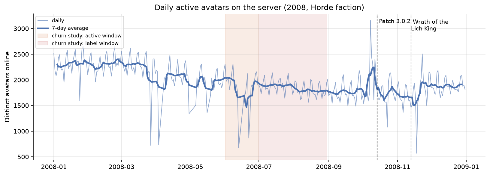

- About **1,900 avatars online per day** (median 1,938). Visible spikes around
  patch 3.0.2 (14 Oct 2008) and the *Wrath of the Lich King* expansion (13 Nov 2008).
  Short drops to < 1,000 are most likely crawler outages.

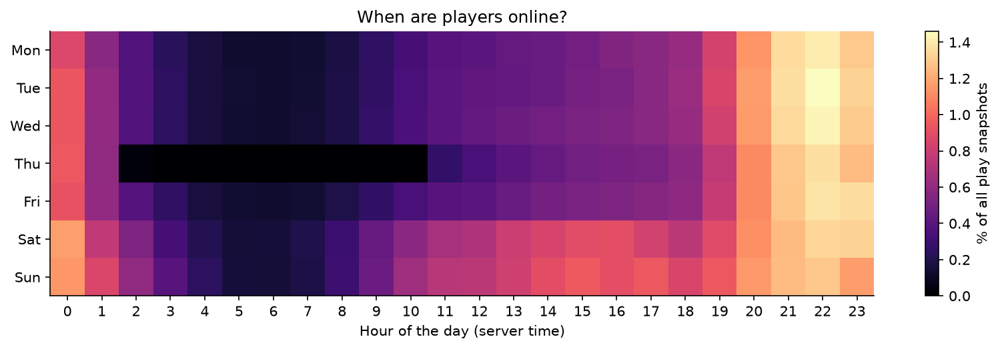

- Peak activity at **22:00** (server time), every day of the week.

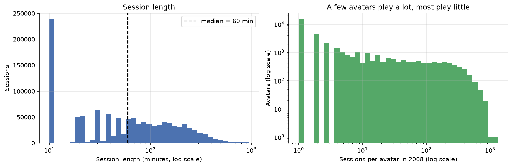

- Median session: **60 minutes**. Very unequal engagement: **40.7 %** of avatars have only
  **one** session in the whole year, while a small core plays hundreds of sessions.

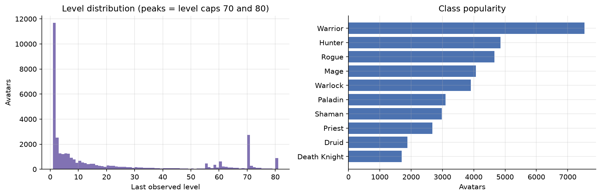
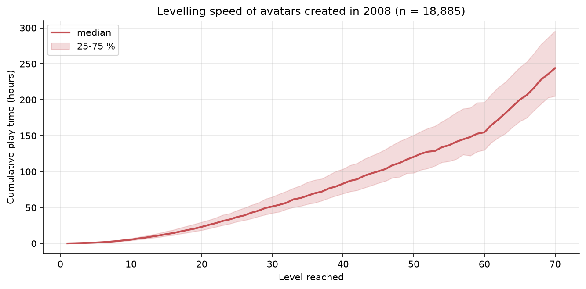

- **18,885 avatars** were first seen at level 1 (created in 2008). Only **14.4 %** of them ever
  reach level 10 and **1.8 %** reach level 70 (the cap before Nov 2008). Those who do need a median
  of **≈ 244 hours** of play. The first levels are where most new characters are lost.

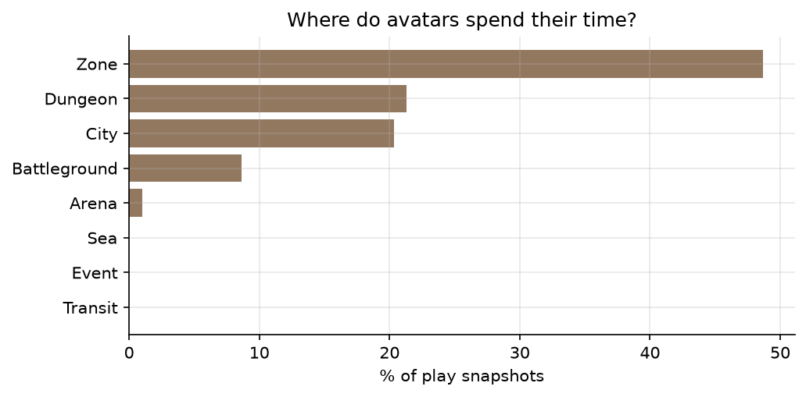

## Part B — Churn definition

- **Snapshot date T = 1 July 2008.** Population = every avatar seen at least once in the 30 days
  before T: **6,918 active avatars**.
- **Churn = not seen at all during the 60 days after T** (1 July – 29 August).
  Churn rate: **29.1 %**.
- **Features** (computed only from data *before* T, so no information from the future):
  level, level gained in 90 days, tenure, recency (days since last login), active days and
  sessions in the last 30 / 90 days, play hours, average session length, play-time trend
  (last 30 days vs. the 30 before), number of zones visited, share of time in cities /
  questing zones / dungeons / PvP (battlegrounds + arenas), guild membership, guild size,
  number of guilds, race, class.

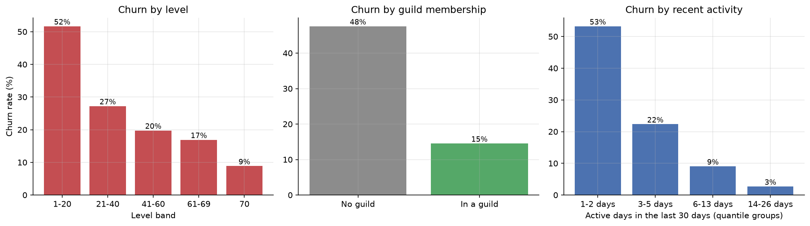

| Group | Churn rate |
|---|---:|
| Level 1–20 / 21–40 / 41–60 / 61–69 / 70 | 52 % / 27 % / 20 % / 17 % / 9 % |
| Not in a guild / in a guild | 47.6 % / 14.5 % |
| 1–2 active days in last 30 / 14–26 active days | 53 % / 3 % |

## Part C — Player segmentation (K-means)

K-means on 9 standardised behaviour features (log-transformed play time, session length and
guild size; active days, level, time shares, ...). *k* was chosen by the **silhouette score**
among k = 3…6 → **k = 3** (silhouette ≈ 0.40; k = 5 is close behind at ≈ 0.39).

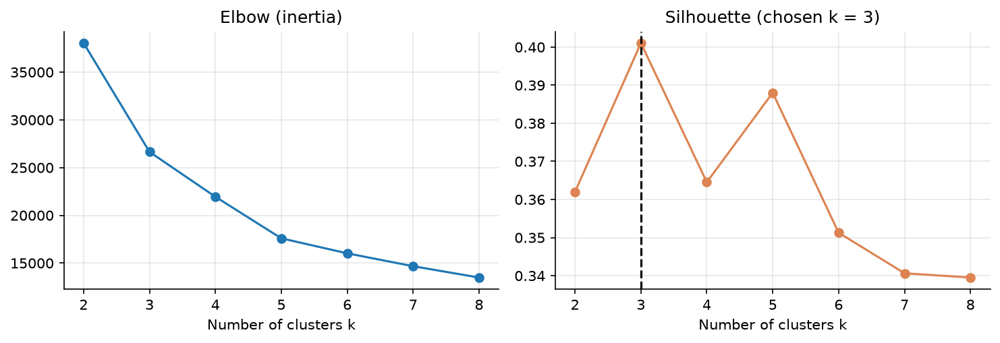
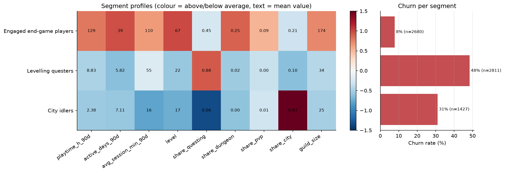

| Segment | Avatars | Typical profile (means) | Churn |
|---|---:|---|---:|
| **Engaged end-game players** | 2,680 | 129 h played in 90 days, 39 active days, level 67, 25 % of time in dungeons, guilds of ~170 avatars | **8 %** |
| **Levelling questers** | 2,811 | 9 h in 90 days, level 22, 88 % of time questing, small guilds | **48 %** |
| **City idlers** | 1,427 | 2.4 h in 90 days, sessions of 16 min, level 17, 93 % of time in a capital city | **31 %** |

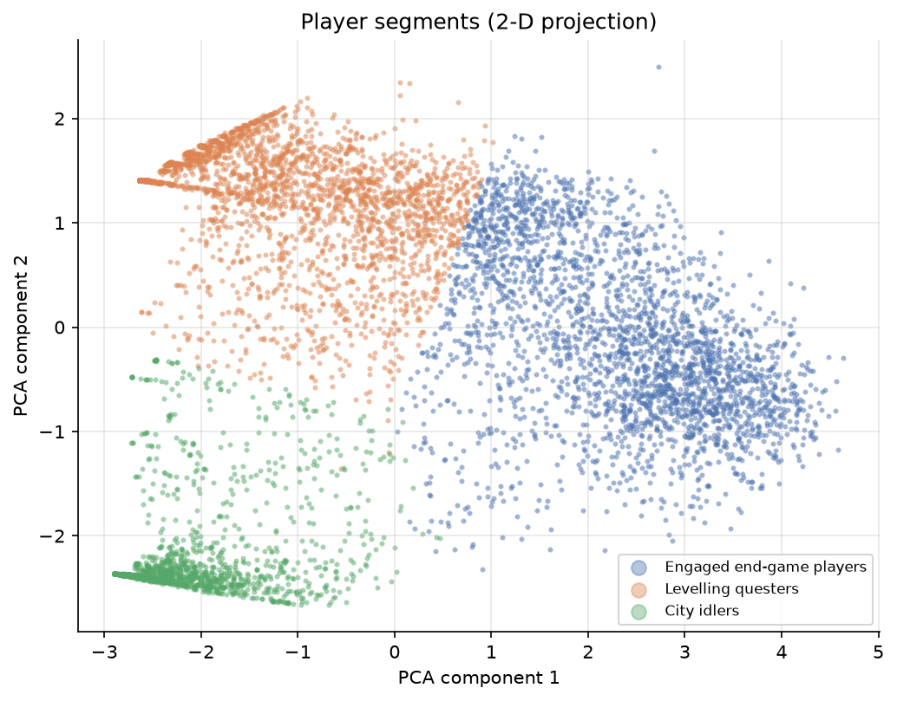

Segment names are given by simple rules on the cluster means (see `name_segment()` in the code).

## Part D — Churn prediction

Stratified 75/25 split (5,188 train / 1,730 test). All models use `class_weight="balanced"`;
threshold 0.5.

| Model | ROC-AUC | PR-AUC | F1 | Precision | Recall | Accuracy | 5-fold CV ROC-AUC | Out-of-time ROC-AUC |
|---|---:|---:|---:|---:|---:|---:|---:|---:|
| Logistic Regression | 0.868 | 0.738 | 0.674 | 0.573 | 0.817 | 0.769 | 0.866 ± 0.005 | 0.862 |
| **Random Forest** | **0.885** | **0.768** | **0.697** | 0.651 | 0.750 | 0.810 | **0.881 ± 0.006** | **0.880** |
| Gradient Boosting | 0.879 | 0.762 | 0.687 | 0.667 | 0.708 | 0.812 | 0.878 ± 0.007 | 0.870 |

*Out-of-time*: the model is trained on a **1 May 2008** snapshot (7,310 avatars, churn 33.7 %)
and tested on all 6,918 avatars of the 1 July snapshot. The score barely drops, so the model
is stable over time on this server. The PR-AUC should be compared with the churn base rate (0.29).

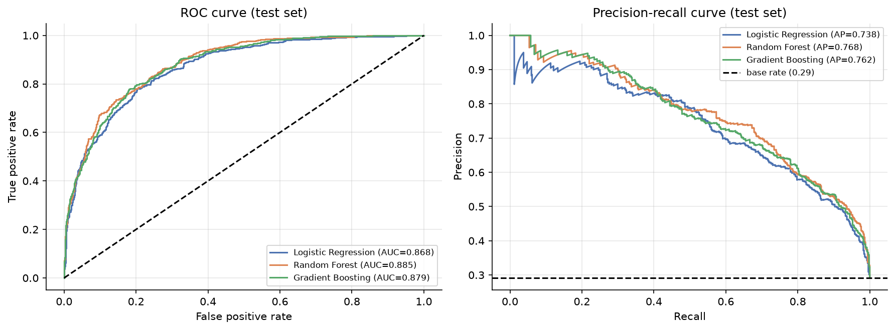

### What predicts churn?

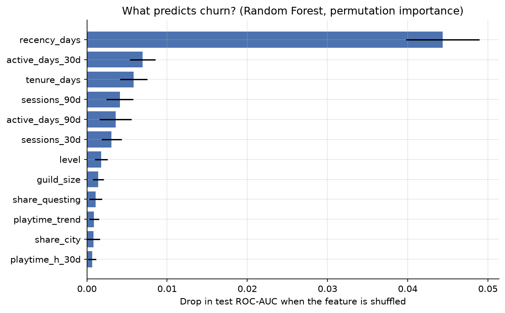

Permutation importance (drop in test ROC-AUC when one feature is shuffled, Random Forest):
**recency** dominates (0.044), followed by active days in the last 30 days (0.007), tenure (0.006)
and number of sessions in 90 days (0.004). Many activity features are correlated, so they
"share" importance: shuffling one alone costs little because the others carry the same signal.

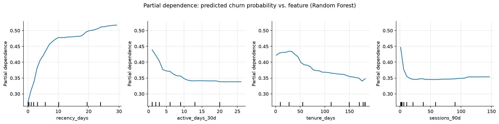

The partial-dependence plots show the shape of the effects: predicted churn rises steeply during
the **first ~7–10 days without logging in**, then flattens; it drops as the number of active days
rises up to ~10 per month; newer avatars (short tenure) are more at risk.

## Recommendations for a game studio

1. **Act on absence quickly.** The risk of leaving grows fastest in the first week without a
   login. Trigger re-engagement (e-mail, in-game reward, "your guild misses you") after
   ~5–7 days of absence rather than after a month.
2. **Fix the early game.** Only 14 % of new characters reach level 10, and churn is 52 % for
   levels 1–20. Shorten the first hours, give clearer goals, and test tutorial changes with A/B tests.
3. **Make players social early.** Guild members churn 3× less (14.5 % vs 47.6 %). A guild finder,
   group content for low levels and rewards for playing together are good bets — but this is a
   correlation, so test it before assuming the guild *causes* retention.
4. **Give "city idlers" something to do.** One in five active avatars spends 93 % of its time in a
   capital city with 16-minute sessions; 31 % of them leave. Bring activities to them: event boards,
   queue-from-the-city dungeons/battlegrounds, short daily quests.
5. **Keep the core happy with regular content.** Engaged end-game players churn only 8 %; the
   activity spikes at the October patch and the November expansion show that new content brings
   players back.
6. **Use the model as a weekly risk score**, re-trained regularly (out-of-time ROC-AUC 0.88), and
   measure the effect of each action with a control group.

## Limitations

- **Avatars are not players**: one person can own several characters (alts). A "churned" avatar may
  simply be an alt that its owner stopped using.
- One server, Horde faction only, year 2008: an old game version; results may not transfer to
  today's games.
- Churn definition (60 days after 1 July) is a choice; summer holidays may influence it. A different
  window would change the rate.
- Data has gaps (crawler outages) and play time is approximated from 10-minute snapshots.
- K-means with k = 3 is a simplification; the silhouette score is moderate (≈ 0.40) and k = 5
  scores almost as well, so a finer segmentation is defensible. Segment names come from simple rules.
- Feature importance shows association, not causation.

## How to run

```bash
python -m venv .venv
.venv\Scripts\activate             # Windows (Linux/macOS: source .venv/bin/activate)
pip install -r requirements.txt
python src/prepare_data.py         # downloads the data (~75 MB) and builds sessions (~2 min)
python src/run_analysis.py         # EDA, segmentation, models, figures (a few minutes on a laptop CPU)
```

`run_analysis.py` also calls the preparation step automatically if the cached files are missing.
Outputs: `figures/` and `outputs/` (CSV/JSON tables: `key_facts.json`, `model_results.csv`,
`segment_profiles.csv`, `permutation_importance.csv`).

## Project structure

```
player-churn-analytics/
├── src/
│   ├── prepare_data.py   # download, cleaning, zone types, sessions
│   └── run_analysis.py   # EDA, churn dataset, K-means, models, recommendations figures
├── figures/  outputs/
├── requirements.txt
├── EXPLICATION_FR.md     # step-by-step explanation in French
└── README.md
```

Author: Ilyas Benderrou.
